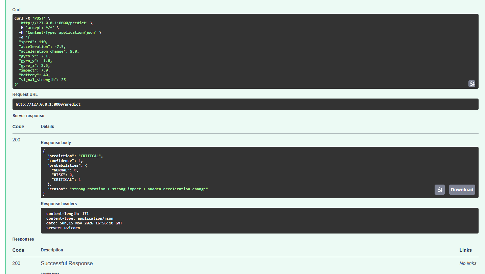

# CATS - Crisis Alert Tech System (Vehicle State Classification)

A small ML prototype that reads one vehicle telemetry record and classifies it as
**NORMAL**, **RISK** or **CRITICAL**. It is a learning prototype, not a certified safety system.

## Project files

```
CATS_Project/
├── CATS_Vehicle_State_Classification.py   # full project (EDA, preprocessing, models, evaluation, explanation)
├── cats_api.py                            # simple FastAPI prediction API
├── data/cats_telemetry.csv                # dataset
├── results.txt                            # full console output (metrics, reports)
├── screenshots/
│   ├── 01_target_distribution.png
│   ├── 02_correlation_heatmap.png
│   ├── 03_model_comparison.png
│   ├── 04_confusion_matrix.png
│   ├── 05_feature_importance.png
│   ├── 06_pairplot.png
│   ├── 07_train_correlation.png
│   └── 08_api_prediction.png
├── requirements.txt
└── README.md
```

## 1. How to install dependencies

Python 3.9 or newer is needed.

```
pip install -r requirements.txt
```

## 2. How to run the project

Open a terminal inside the `CATS_Project` folder (the `data` folder must be next to the script) and run:

```
python CATS_Vehicle_State_Classification.py
```

The script prints the results and opens the plots one by one. Close each plot window to continue.

## 3. Dataset

`data/cats_telemetry.csv` has 3,015 rows (15 exact duplicates, and about 3% missing values in the
sensor columns). All feature columns are numeric, so there are no categorical features.

| Column | Meaning |
|---|---|
| record_id | row number (dropped before training) |
| speed | vehicle speed |
| acceleration | acceleration |
| acceleration_change | sudden change in acceleration |
| gyro_x, gyro_y, gyro_z | rotation / motion sensor values |
| impact | impact-related value |
| battery | device battery level (%) |
| signal_strength | signal quality (0-100) |
| state | target: NORMAL, RISK or CRITICAL |

Class split after removing duplicates: NORMAL 2100 (70%), RISK 660 (22%), CRITICAL 240 (8%) - imbalanced.

Derived features: `gyro_magnitude` (combined rotation from x, y, z) and `abs_accel_change`
(size of sudden acceleration change).

## 4. Pipeline (no data leakage)

Everything that learns from data is fitted on the **training set only** and then applied to the test set.

| Phase | What is done |
|---|---|
| 1. Cleaning | Drop `record_id`, drop duplicates (before split) |
| 2. EDA | All plots are drawn before the split |
| 3. Split | 80/20 stratified train/test |
| 4. Missing values | `SimpleImputer` (median), fit on train, applied to train and test |
| 5. Outliers | IQR rule inside each class, **train only** (test is not touched) |
| 6. New features | `gyro_magnitude`, `abs_accel_change` (row-wise, no leakage) |
| 7. Encoding | One-hot encoding, fit on train, only if categorical columns exist (none in this dataset) |
| 8. Feature selection | Pearson correlation with target > 0.30 on train (chi2 with p < 0.05 would be used for one-hot encoded categorical columns) |
| 9. Scaling | `StandardScaler`, fit on train, applied to test |
| 10. Imbalance | Smallest/biggest class ratio is 0.116, so SMOTE is applied to train only, after scaling |
| 11. Models | Random Forest, XGBoost, AdaBoost, SVM with `GridSearchCV` (5-fold, macro F1). SMOTE runs inside the CV pipeline, so validation folds stay untouched |

**How the 6 features were selected:** the absolute Pearson correlation of each numeric feature with the
target is calculated on the **training data only**, and features with correlation **above 0.30** are kept.
The other 5 features fall below the threshold and are dropped.

| Feature | Correlation with target (train) | Kept |
|---|---|---|
| impact | 0.843 | Yes |
| gyro_magnitude | 0.840 | Yes |
| abs_accel_change | 0.652 | Yes |
| signal_strength | 0.590 | Yes |
| speed | 0.468 | Yes |
| acceleration | 0.429 | Yes |
| battery | 0.219 | No |
| gyro_x | 0.079 | No |
| gyro_z | 0.023 | No |
| gyro_y | 0.017 | No |
| acceleration_change | 0.012 | No |

The bar plot of these values is in `screenshots/07_train_correlation.png`.

Each model is trained on **all features (11)** and on the **selected features (6)**.

## 5. Evaluation results

Full output is in `results.txt`. Test set: 600 rows. Precision, recall and F1 are macro averages over the 3 classes.

| Features | Model | Best params | Accuracy | Precision | Recall | Macro F1 | CRITICAL recall |
|---|---|---|---|---|---|---|---|
| All | Random Forest | depth 12 | 0.9717 | 0.9467 | 0.9682 | 0.9571 | 0.9792 |
| All | XGBoost | depth 3 | 0.9683 | 0.9448 | 0.9632 | 0.9537 | 0.9792 |
| All | AdaBoost | lr 0.5, 100 est. | 0.9467 | 0.9045 | 0.9519 | 0.9260 | 0.9583 |
| All | SVM | C = 1 | 0.9783 | 0.9551 | 0.9591 | 0.9571 | 0.9375 |
| Selected | Random Forest | depth 8 | 0.9667 | 0.9338 | 0.9676 | 0.9499 | 0.9792 |
| Selected | XGBoost | depth 8 | 0.9667 | 0.9325 | 0.9624 | 0.9466 | 0.9792 |
| Selected | AdaBoost | lr 0.5, 100 est. | 0.9567 | 0.9200 | 0.9584 | 0.9378 | 0.9583 |
| **Selected** | **SVM** | **C = 0.1** | **0.9833** | **0.9670** | **0.9694** | **0.9681** | **0.9583** |

**Best model:** SVM (RBF) on the 6 selected features, chosen by highest macro F1.

Precision, recall and F1 for each class (best model):

| Class | Precision | Recall | F1-score | Support |
|---|---|---|---|---|
| NORMAL | 0.99 | 1.00 | 0.99 | 420 |
| RISK | 0.97 | 0.95 | 0.96 | 132 |
| CRITICAL | 0.94 | 0.96 | 0.95 | 48 |

Confusion matrix (rows = true, columns = predicted):

| | NORMAL | RISK | CRITICAL |
|---|---|---|---|
| NORMAL | 418 | 2 | 0 |
| RISK | 3 | 126 | 3 |
| CRITICAL | 0 | 2 | 46 |

How to read this: precision is "when the model says this class, how often is it right", and recall is
"of the real cases of this class, how many did the model find". For CRITICAL, 46 of 48 cases were found
(recall 0.96) and 2 were predicted as RISK.

Most important features (Random Forest, all features): `impact` (0.36), `gyro_magnitude` (0.34), `abs_accel_change` (0.08).

## 6. How to test a new telemetry record

At the bottom of `CATS_Vehicle_State_Classification.py`, change the values in `predict_new({...})`:

```python
predict_new({
    "speed": 110,
    "acceleration": -7.5,
    "acceleration_change": 9.0,
    "gyro_x": 2.1,
    "gyro_y": -1.8,
    "gyro_z": 2.5,
    "impact": 7.0,
    "battery": 40,
    "signal_strength": 25
})
```

Run the script again. The last output shows the prediction, confidence and a short reason:

```
Prediction: CRITICAL
Confidence: 1.00
Reason: strong rotation + strong impact + sudden acceleration change
```

Confidence is the model's predicted probability for the chosen class, not the real probability of a crash.
If a sensor value is missing, use `np.nan`; it is filled with the training median.

## 7. API / integration code

`cats_api.py` is a small FastAPI backend that classifies new telemetry in real time. It follows the same
pipeline as the main file (median imputation, per-class IQR outlier removal, derived features, correlation
feature selection, scaling, SMOTE) and trains the best model (SVM, C = 0.1) when it starts, so
**no trained model file is saved or needed**. It uses all rows for training because it has no test set.

Run it from the `CATS_Project` folder (the `data` folder must be next to the file):

```
uvicorn cats_api:app --reload
```

Then open `http://127.0.0.1:8000/docs` to test it in the browser, or send a request:

```
curl -X POST http://127.0.0.1:8000/predict -H "Content-Type: application/json" -d '{"speed": 110, "acceleration": -7.5, "acceleration_change": 9.0, "gyro_x": 2.1, "gyro_y": -1.8, "gyro_z": 2.5, "impact": 7.0, "battery": 40, "signal_strength": 25}'
```

Example response:

```
{
  "prediction": "CRITICAL",
  "confidence": 1.0,
  "probabilities": {"NORMAL": 0.0, "RISK": 0.0, "CRITICAL": 1.0},
  "reason": "strong rotation + strong impact + sudden acceleration change"
}
```

A missing sensor value can be left out or sent as `null`; it is filled with the training median.

Example request and response from the running API:



This is a prototype: it has no login, no data storage and no connection to a real CATS bot.